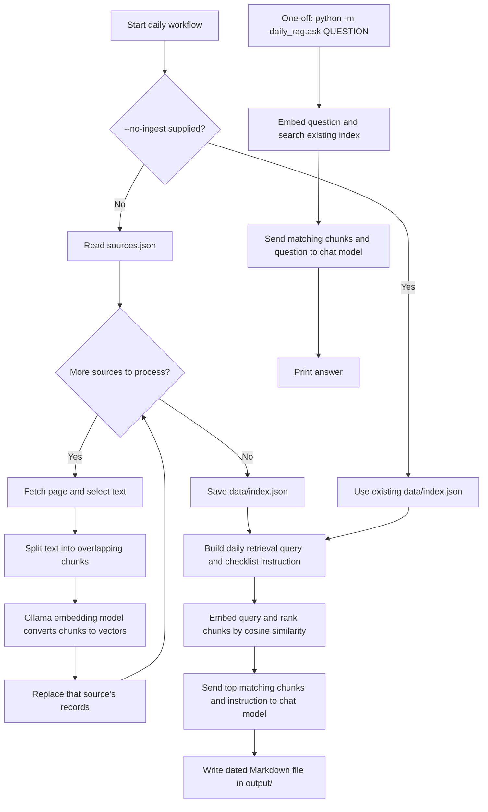

# daily-rag

`daily-rag` is a small command-line RAG (retrieval-augmented generation) application. It downloads text from a list of web pages, stores text chunks and their embeddings locally, finds chunks related to a question, and asks a local Ollama language model to answer using those chunks.

The daily workflow combines news with your resume, project roadmap, and self-reported progress to produce constructive coaching, trackable tasks, and all-day calendar events in `output/`. Model requests use your local Ollama service, not a hosted API.

## How The Pieces Fit

There are two workflows:

- `daily_rag.daily` refreshes the sources and personal documents, plans tasks, and writes `output/YYYY-MM-DD.md` and `output/tasks.ics`.
- `daily_rag.ask` asks a one-off question using the existing web index, current personal documents, and task history.
- `daily_rag.tasks` lists tracked tasks and records outcomes, blockers, and feedback.

The pipeline is:



### Daily run, step by step

1. Unless `--no-ingest` is present, `daily_rag.daily` calls `ingest()`.
2. Ingestion reads `sources.json`, then fetches each URL. If a source has a CSS `selector`, only matching page elements are extracted; otherwise the page body is used. Common non-content elements such as scripts, navigation, and footers are removed.
3. The text is split into overlapping character-based chunks. The embedding model turns every chunk into a numeric vector that represents its meaning.
4. Each chunk, vector, source URL, and fetch time is saved in `data/index.json`. Existing records for a successfully fetched URL are replaced. If fetching or embedding one source fails, that source is skipped and ingestion continues; existing records for that URL are left in place.
5. Local Markdown, text, and PDF documents are refreshed by content hash. Deleted files are removed from the current snapshot. Full document text is supplied separately from web retrieval so roadmap rules and resume context cannot be crowded out by news.
6. An interactive check-in is collected before planning. The planner receives the current documents, recent check-ins, open work, and the latest 30 closed tasks. Web news stays separate from task planning so it cannot distract from roadmap prerequisites.
7. The model returns structured tasks and observations, selecting specific evidence lines. The app validates the schema, task cap, and evidence identifiers, then attaches supporting quotes directly from the source rather than trusting model-generated quotations. Unfinished/blocked work carries forward before new work is added. The separate news response remains topic-oriented.
8. The result is written to `output/<today>.md`; `output/tasks.ics` contains all tracked task events. Rerunning the same day reuses that day's plan rather than inventing more tasks, while refreshing local documents and regenerating the news and calendar output.

The one-off `ask` workflow uses the existing web index but always refreshes personal documents. Its question is used both to retrieve web chunks and as the instruction for the chat model.

## Setup And Run

Run these commands from the repository root (`daily-rag/`), because source, index, and output paths are relative to the current working directory.

1. Install Python 3.10 or newer.
2. Create your local config from the tracked example, which includes every configuration field:

   ```sh
   cp daily_rag/config.example.py daily_rag/config.py
   ```

   Edit `daily_rag/config.py` for your models, paths, and profile. This local file is ignored by Git; keep `daily_rag/config.example.py` up to date when adding configuration fields. If you already have a local config, keep it rather than overwriting it.
3. Install and start [Ollama](https://ollama.com/), then download the models configured in `daily_rag/config.py`:

   ```sh
   ollama pull llama3.2
   ollama pull nomic-embed-text
   ```

   Keep the Ollama service running while using the application.
4. Create and activate a virtual environment, then install this project's Python dependencies:

   ```sh
   python3 -m venv .venv
   source .venv/bin/activate
   python -m pip install -e .
   ```

5. Generate a daily digest (this fetches the configured sources first):

   ```sh
   python -m daily_rag.daily
   ```

6. Ask a one-off question against the saved index:

   ```sh
   python -m daily_rag.ask "What AI tooling news should I look into?"
   ```

Useful variations:

```sh
python -m daily_rag.ingest                 # Refresh the index without generating a digest
python -m daily_rag.daily --no-ingest      # Generate from the current index without fetching pages
python -m daily_rag.daily --no-check-in    # Skip interactive check-in prompts
```

The first ingestion creates `data/index.json`. `output/` is created automatically when the daily workflow writes its result.

## Personal Coaching And Calendar Tasks

Put your resume and roadmap in `personal-context/`. Supported formats are `.pdf` (with selectable text), `.md`, and `.txt`, including subfolders. Scanned PDFs need OCR first; unreadable/empty documents and extraction errors stop the run rather than silently using stale text. Hidden files are ignored; symlinks are rejected. Other formats are not ingested.

In your existing `daily_rag/config.py`, add these fields if you created it before the coaching feature:

```python
PERSONAL_CONTEXT_DIR = "personal-context"
PERSONAL_CONTEXT_CACHE = "data/personal-context.json"
PERSONAL_CONTEXT_MAX_CHARS = 40000
TASKS_PATH = "data/tasks.json"
DAILY_TASK_LIMIT = 2
MODEL_CONTEXT_TOKENS = 32768
```

The two-task default matches the current roadmap. `DAILY_TASK_LIMIT` accepts 1–3. In documents whose filename contains `roadmap`, unchecked Markdown items (`[ ]`, including table cells) are queued in source order, excluding checked items, already tracked titles, and the `Parking lot` section. This deterministic queue takes priority over model-generated tasks: the model cannot replace the first roadmap steps with unrelated resume or news tasks. Outcomes in the task log advance the queue even if you have not edited the original checkboxes yet.

The model supplies constructive observations and can propose additional tasks when carryover and roadmap work leave capacity. It is instructed to honor lower roadmap budgets, prerequisites, alternating tracks, and non-goals, and not to convert sequence numbers into deadlines; review those semantics yourself and update `DAILY_TASK_LIMIT` if your budget changes. The app enforces the configured cap and rejects exact-title repeats; it cannot reliably detect paraphrased duplicates. When personal documents exist and no work is carried over or queued, at least one grounded task is required (an artifact/status review if progress is uncertain). An empty saved plan is reconsidered when personal context is available.

The coach prioritizes specific criticism over encouragement:

- **Resume updates:** identify project results that could justify a new bullet, with an artifact or result to verify. Never invent achievements. Recommendations can appear in the coaching review even when roadmap tasks fill the calendar budget.
- **Project learning:** connect a learning task to the earliest unfinished project work and define a concrete output, such as a test, diagram, or short implementation.
- **Weak spots:** distinguish observed blockers from *missing evidence*. A skill absent from a resume is not proof you lack it.

Until you have recorded an outcome or check-in, the review explicitly says there is insufficient progress evidence rather than asking the model to invent a weakness from your resume. When roadmap tasks fill the day's budget and no outcomes exist yet, the task plan is generated directly from the queue without a planning-model call.

Recorded outcomes also produce deterministic coaching: blocked work gets a blocker count and an artifact-based recovery step, skipped work triggers a scope review, and completed work triggers artifact verification and a conditional resume review. These take precedence over speculative model criticism. If carryover and roadmap items fill the budget and these reviews are available, no planning-model call is needed. The model remains available for additional task recommendations when capacity remains, check-in-only reviews, and one-off coaching questions.

Current documents are provided in full, subject to the character limit above; exceeding the limit fails explicitly instead of silently dropping part of the roadmap. The Ollama context window defaults to 32K tokens; larger documents/history may require a larger model-supported window or shorter context. Content hashes refresh extraction only when files change. Historical evidence cited by a plan is retained in `data/tasks.json` even after documents change or are deleted, so you can audit why a task was recommended. This is retrieval and history, not model training.

### Feedback loop

```sh
python -m daily_rag.tasks list
python -m daily_rag.tasks update TASK_ID done --note "Added endpoint tests; artifact: commit abc123"
python -m daily_rag.tasks update TASK_ID blocked --note "Migration fails; need to fix the schema first"
python -m daily_rag.tasks update TASK_ID skipped --note "No longer relevant after scope change"
python -m daily_rag.tasks update TASK_ID planned --note "Blocker resolved; ready to resume"
```

Use the actual ID printed in the digest or task list. Completion feedback should name the result or artifact, not just say "done." Status changes and notes are timestamped and retained; they are **self-reported**, not independently verified. Editing Markdown checkboxes or marking a calendar event complete does **not** update the task log. Feedback updates the calendar immediately, informs the next day's plan, and is available to `daily_rag.ask` immediately. A saved same-day plan's assessment is not regenerated after feedback or document edits.

For the strongest loop, record a brief result/blocker after each task, update roadmap checkboxes yourself, and do a weekly review using:

```sh
python -m daily_rag.ask "Review my recent outcomes and blockers against my roadmap. What should I cut, practice next, or add to my resume? Cite evidence and label uncertainty."
```

### Calendar behavior

Open/import `output/tasks.ics` in a calendar app. Events are all-day, with an exclusive next-day end date; they do not assume your availability, invent deadlines, or reserve busy time. Descriptions contain the reason, completion criterion, evidence references, task ID, and feedback. Unfinished/blocked tasks move forward with stable event UIDs and increasing revisions. Completed events are labeled `done`; skipped events are marked cancelled.

This is a **local export**, not a calendar account integration or subscription server. Re-import behavior varies by calendar app: stable UIDs support updates, but some clients may duplicate imported events or ignore cancellations. Use a dedicated calendar you can replace/re-import if needed. No external events are created automatically and there is no reverse sync.

### Privacy

`personal-context/`, `data/`, and `output/` are Git-ignored. Extracted resume text, feedback, evidence snapshots, and calendar descriptions can contain sensitive information. Keep them local and avoid sharing the export or log unintentionally. Documents go to the local Ollama endpoint only; do not configure it to use a remote service if you want this privacy boundary. Removing a source file removes it from current context, but does not erase historical evidence in the task log or already exported events.

## Change What It Reads

Edit `sources.json`. Each entry needs a URL and may include a CSS selector:

```json
[
  { "url": "https://news.ycombinator.com/", "selector": ".titleline" },
  { "url": "https://www.anthropic.com/news" }
]
```

Use a selector that targets the actual content you want, not a large page wrapper full of navigation. Browser developer tools can help identify a page's CSS classes. If a selector matches nothing, that source will produce no useful chunks. After changing sources, run `python -m daily_rag.ingest` or the normal daily command to refresh the index.

## Make Results Clearer And More Relevant

The main controls live in `daily_rag/config.py`, the coaching instructions in `daily_rag/coaching.py`, and the news `answer(...)` call in `daily_rag/daily.py`.

- **Who the digest is for:** edit `PROFILE`. Be specific about role, interests, goals, and what counts as actionable. This profile influences both the daily retrieval query and the chat model's system message.
- **What to retrieve:** the first string passed to `answer(query, instruction)` in `daily.py` is the retrieval query. Name the topics and desired relevance explicitly. Better query: `software engineering, AI developer tools, product launches, and startup news relevant to my work`.
- **How to format and judge the answer:** the second string in the news `answer(...)` call is the news instruction. Coaching tasks have a separate validated JSON schema, daily cap, evidence references, and completion criteria.
- **How much context to retrieve:** `TOP_K` controls how many chunks are passed to the model. Raising it can improve coverage but also add noise; lowering it can make answers more focused but miss relevant material.
- **Chunk boundaries:** `CHUNK_SIZE` and `CHUNK_OVERLAP` are character counts, not token counts. Larger chunks preserve more surrounding context but can dilute relevance. More overlap preserves context across boundaries but increases storage and duplicate content.
- **Models:** `EMBED_MODEL` creates vectors; `CHAT_MODEL` writes the answer. If you change the embedding model, re-ingest all sources before searching so the stored vectors and query vector come from the same model. The chat model can be changed independently, provided it is available in Ollama.

For a clearer daily result, start by tightening the source list and selectors, then make `PROFILE` concrete, then refine the retrieval query and output instruction. Change one thing at a time and compare the resulting Markdown. The one-off `ask` command currently uses the same text as both its search query and answer instruction, so it works best when the question itself is precise (for example, `Summarize recent AI developer-tool launches and explain which are relevant to a Python engineer`).

### Current limitations to keep in mind

- Chunks are cut by character position, not sentence or document structure.
- Search always returns up to `TOP_K` results; there is no minimum relevance threshold, so weak matches can still reach the model.
- The stored `fetched_at` timestamp is not currently used to rank or filter results.
- Citations are source URLs attached to chunks, not verified links to individual claims. The model can still produce unsupported details, so check important dates, deadlines, and claims against the source.
- A fetch failure is printed and skipped, but does not fail the whole run. That means an older indexed version of that source may remain available.
- Evidence identifiers are validated and supporting quotes are copied directly from source snapshots, but the model's interpretation of evidence is not independently verified. Invalid planner JSON, unknown evidence, or too many tasks stop planning without saving a new plan; check the error and rerun.

## Python Concepts Used Here

- **Modules and packages:** Python files under `daily_rag/` are modules in the `daily_rag` package. Relative imports such as `from .embed import embed` connect them.
- **Functions and return types:** `def fetch_text(...) -> str` defines a function and annotates the expected return type. Annotations help readers and tools; they do not automatically validate values at runtime.
- **Lists and dictionaries:** chunks are lists of strings; each saved record is a dictionary with keys such as `text`, `embedding`, and `url`.
- **Type hints:** examples include `list[str]`, `list[dict]`, and `str | None`. The `| None` syntax means a value can be either a string or `None`.
- **Loops and comprehensions:** `for` loops process sources and chunks. List comprehensions build records and filter old records.
- **Optional arguments and defaults:** `selector=None` and `top_k=config.TOP_K` let callers omit optional choices.
- **Exceptions:** `try` / `except` lets ingestion report a failed source and continue with the next one.
- **Standard library modules:** `pathlib.Path` handles files and directories; `json` reads and writes JSON; `datetime` adds timestamps; `sys.argv` reads command-line arguments; `math` supports cosine similarity; `re` cleans whitespace.
- **Third-party packages:** `httpx` downloads pages, `BeautifulSoup` parses HTML, and `ollama` calls local embedding and chat models.
- **Comprehensions, `zip`, and `lambda`:** ingestion pairs chunks with vectors using `zip`; search uses a small `lambda` as its sort key.
- **Module entry points:** `daily_rag.ingest` has an `if __name__ == "__main__":` guard. `daily_rag.daily` and `daily_rag.ask` run their workflows when launched with `python -m`.
- **f-strings:** expressions such as `f"# To-do for {today}"` insert values into strings.

## Project Map

| File | Responsibility |
| --- | --- |
| `daily_rag/daily.py` | Daily workflow and Markdown output |
| `daily_rag/ask.py` | One-off command-line question |
| `daily_rag/ingest.py` | Refresh personal documents and ingest web sources |
| `daily_rag/personal.py` | Hash and extract local Markdown/text/PDF context |
| `daily_rag/coaching.py` | Generate and validate evidence-based daily plans |
| `daily_rag/tasks.py` | Persist plans, evidence, task outcomes, and feedback CLI |
| `daily_rag/calendar.py` | Export all-day task events with stable IDs |
| `daily_rag/fetch.py` | Download and extract page text |
| `daily_rag/chunk.py` | Split text into overlapping chunks |
| `daily_rag/embed.py` | Create embeddings with Ollama |
| `daily_rag/store.py` | Read/write JSON index and rank matches |
| `daily_rag/generate.py` | Build model messages and generate an answer |
| `daily_rag/config.py` | Models, retrieval settings, paths, and user profile |
| `sources.json` | Web pages to ingest and optional CSS selectors |
| `data/index.json` | Generated chunk and embedding index |
| `output/` | Generated daily Markdown files |